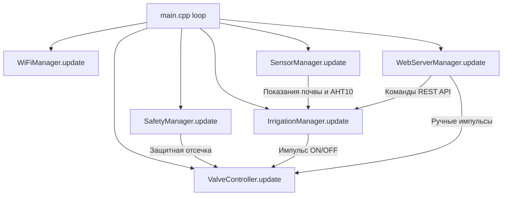

# 🌱 Smart Garden Irrigation System — ESP32-C3 SuperMini

Локальная автономная Web-система автоматического полива сада и мониторинга микроклимата на базе микроконтроллера **ESP32-C3 SuperMini**.

Система оснащена современным адаптивным веб-интерфейсом в тёмной теме, функционирует полностью локально без облачных сервисов и внешних серверов, сохраняет полную автономность при потере связи и управляет 220В клапаном через релейный модуль **CR-NAC100** с гальванической развязкой на **оптопарах 4N35**.

---

## 📑 Содержание

1. [Ключевые возможности](#1-ключевые-возможности)
2. [Аппаратная часть и компоненты](#2-аппаратная-часть-и-компоненты)
3. [Электрическая схема и распиновка](#3-электрическая-схема-и-распиновка)
4. [Архитектура прошивки](#4-архитектура-прошивки)
5. [Режимы работы и безопасность](#5-режимы-работы-и-безопасность)
6. [Веб-интерфейс управления](#6-веб-интерфейс-управления)
7. [Пошаговая инструкция по настройке](#7-пошаговая-инструкция-по-настройке)
8. [Инструкция по сборке и прошивке](#8-инструкция-по-сборке-и-прошивке)
9. [Справочник REST API](#9-справочник-rest-api)
10. [Электробезопасность при работе с 220В](#10-электробезопасность-при-работе-с-220в)
11. [Диагностика и устранение неполадок (FAQ)](#11-диагностика-и-устранение-неполадок-faq)

---

## 1. Ключевые возможности

* **Полная автономность:** контроллер принимает решения на основе показаний датчиков почвы локально. Закрытие браузера или потеря Wi-Fi сигнала не прерывают полив и не отключают защитные механизмы.
* **Безопасное импульсное управление CR-NAC100:** вместо радиопередатчика 433 МГц релейный модуль управляется двумя оптопарами 4N35 короткими импульсами (250 мс), имитирующими нажатие кнопок ON и OFF.
* **Аппаратная и программная взаимная блокировка:** исключено одновременное срабатывание команд ON и OFF, внедрён защитный кулдаун между импульсами.
* **Двухрежимный Wi-Fi (Station + Fallback AP):** автоподключение к домашней сети с периодическим авто-реконнектом. При отсутствии сети поднимается резервная точка доступа `Garden-Watering-AP` (192.168.4.1) для первичной настройки.
* **Встроенный минималистичный Web-интерфейс:** стильная тёмная тема, адаптивная вёрстка под смартфоны и десктоп, живые показания датчиков без перезагрузки страницы, нулевая зависимость от внешних CDN (работает на 100% офлайн).
* **Многоуровневая система безопасности:**
  * Ограничение максимальной длительности одного полива (по умолчанию 10 минут).
  * Автоматическая отсечка при 3 последовательных сбоях аналоговых датчиков.
  * Разделение расчётного и подтверждённого физического состояния клапана.
  * Гарантированный возврат пинов в `LOW` при старте и перезагрузке микроконтроллера.
* **Встроенный Демо-симулятор:** возможность протестировать веб-интерфейс, анимации полива и динамику датчиков без подключенного «железа».

---

## 2. Аппаратная часть и компоненты

| Компонент | Модель / Спецификация | Назначение в системе |
| :--- | :--- | :--- |
| **Микроконтроллер** | ESP32-C3 SuperMini (RISC-V 160 МГц, 4MB Flash, Wi-Fi 2.4 GHz) | Основной вычислительный узел, веб-сервер и автомат полива |
| **Датчики почвы** | 3 × HW-390 (ёмкостные, влагостойкие, 3.3В) | Измерение влажности грунта в трёх разных точках сада/грядки |
| **Датчик климата** | AHT10 (I2C шина, адрес `0x38`) | Контроль температуры (-40...+85 °C) и влажности воздуха (0...100%) |
| **Силовое реле** | CR-NAC100 (двухканальное реле 220В с кнопочным управлением) | Коммутация питания 220В электромагнитного клапана |
| **Оптопары** | 2 × 4N35 (NPN-фототранзистор, изоляция до 5 кВ) | Гальваническая развязка для импульсного замыкания кнопок ON и OFF |
| **Резисторы** | 2 × 220...330 Ом (0.125 или 0.25 Вт) | Токоограничивающие резисторы для входных светодиодов оптопар |
| **Клапан** | Соленоидный клапан 220В AC, нормально закрытый (NC) | Подача воды на оросительную линию при подаче питания |
| **Питание** | Блок питания 5В (2А) через Type-C или стабилизатор | Питание ESP32 и датчиков |

---

## 3. Электрическая схема и распиновка

### 3.1. Распиновка ESP32-C3 SuperMini

```
                  ┌──────────────────────┐
            3.3V ─┤                      ├─ 5V (Вход питания)
             GND ─┤      ESP32-C3        ├─ GND
   (ADC1_CH4) G4 ─┤     SuperMini        ├─ G3 (ADC1_CH3)
   (ADC2_CH0) G5 ─┤                      ├─ G2 (ADC1_CH2 / Strapping)
              G6 ─┤                      ├─ G1 (ADC1_CH1)
              G7 ─┤                      ├─ G0 (ADC1_CH0)
      (SDA)   G8 ─┤                      ├─ G10
      (SCL)   G9 ─┤                      ├─ G20 (RX)
                  └──────────────────────┘
```

| Компонент / Линия | Пин ESP32-C3 | Тип вывода | Примечания по подключению |
| :--- | :--- | :--- | :--- |
| **HW-390 #1 (AOUT)** | **GPIO 4** | ADC1_CH4 | Аналоговый вход (12 бит, 0...4095) |
| **HW-390 #2 (AOUT)** | **GPIO 5** | ADC2_CH0 | Аналоговый вход (или переназначаемый в меню) |
| **HW-390 #3 (AOUT)** | **GPIO 1** | ADC1_CH1 | Безопасный вход ADC1 (не конфликтует с Wi-Fi) |
| **AHT10 SDA** | **GPIO 8** | I2C Data | Аппаратная подтяжка 4.7кОм к 3.3В |
| **AHT10 SCL** | **GPIO 9** | I2C Clock | Кнопка BOOT, внутренняя подтяжка к 3.3В |
| **Оптопара ON (Анод)** | **Конфигурируемый (-1)** | Digital OUT | Назначается пользователем (например, GPIO 10 или GPIO 3) |
| **Оптопара OFF (Анод)**| **Конфигурируемый (-1)** | Digital OUT | Назначается пользователем (например, GPIO 7 или GPIO 0) |

> ⚠️ **Важно:** По умолчанию номера GPIO оптопар установлены в `-1`. До их назначения в веб-интерфейсе импульсы блокируются, что предотвращает случайные включения при первом старте.

---

### 3.2. Схема подключения оптопар 4N35 к реле CR-NAC100

```
  ESP32-C3                    Оптопара 4N35                     Плата CR-NAC100
 ┌──────────┐              ┌─────────────────┐               ┌──────────────────┐
 │          │   220-330 Ом │  1 (Анод)    6  │               │ Физическая кнопка│
 │ GPIO_ON  ├───██████─────┤                 │               │ "ON"             │
 │          │              │  2 (Катод) 5 ───┼───────────────┤ Контакт A        │
 │   GND    ├──────────────┤           (Колл)│               │                  │
 │          │              │  3 (NC)    4 ───┼───────────────┤ Контакт B        │
 └──────────┘              └───────────(Эмит)┘               └──────────────────┘

 ┌──────────┐              ┌─────────────────┐               ┌──────────────────┐
 │          │   220-330 Ом │  1 (Анод)    6  │               │ Физическая кнопка│
 │ GPIO_OFF ├───██████─────┤                 │               │ "OFF"            │
 │          │              │  2 (Катод) 5 ───┼───────────────┤ Контакт A        │
 │   GND    ├──────────────┤           (Колл)│               │                  │
 │          │              │  3 (NC)    4 ───┼───────────────┤ Контакт B        │
 └──────────┘              └───────────(Эмит)┘               └──────────────────┘
```

* **Неактивный уровень:** `LOW` (светодиод оптопары обесточен, контакты кнопки разомкнуты).
* **Активный импульс:** `HIGH` на **250 мс** (светодиод оптопары зажигается, фототранзистор кратковременно замыкает контакты кнопки).
* **Вывод 6 оптопары (Base):** оставляется неподключенным (NC).

---

### 3.3. Подключение силовой части 220В

```
  Сеть 220В AC               Модуль CR-NAC100               Клапан 220В NC
 ┌───────────────┐          ┌─────────────────┐          ┌─────────────────┐
 │ Фаза (L)      ├──────────┤ L_IN            │          │                 │
 │               │          │                 │          │                 │
 │               │          │ L_OUT (NO Реле) ├──────────┤ Контакт 1       │
 │               │          │                 │          │                 │
 │ Ноль (N)      ├────┬─────┤ N_IN            │          │                 │
 │               │    │     └─────────────────┘          │                 │
 │               │    └──────────────────────────────────┤ Контакт 2       │
 └───────────────┘                                       └─────────────────┘
```

При обесточивании клапан закрыт силой возвратной пружины. Вода поступает в систему полива только при активной подаче 220В на соленоид.

---

## 4. Архитектура прошивки

Проект организован по модульному принципу: каждый компонент вынесен в изолированный класс. Задержки реализованы исключительно на программных таймерах `millis()`, благодаря чему веб-сервер и опрос датчиков не зависают.

```
Garden-watering-assistant/
├── platformio.ini           # Скрипт сборки PlatformIO
├── include/
│   ├── Config.h             # Дефолтные константы, структуры данных и тайминги
│   ├── SettingsManager.h    # Хранение конфигурации в NVS (Preferences)
│   ├── WiFiManager.h        # Управление Station / AP и фоновым переподключением
│   ├── SensorManager.h      # Опрос и фильтрация HW-390 и чтение I2C AHT10
│   ├── ValveController.h    # Управление импульсами оптопар 4N35 и взаимная блокировка
│   ├── SafetyManager.h      # Таймер макс. времени (10 мин) и контроль ошибок сенсоров
│   ├── IrrigationManager.h  # Автомат гистерезиса автополива
│   ├── WebServerManager.h   # Маршрутизатор REST API и раздача статики
│   └── WebInterface.h       # Скомпилированный в PROGMEM веб-интерфейс
├── src/
│   ├── main.cpp             # Точка входа: setup() и неблокирующий loop()
│   ├── SettingsManager.cpp
│   ├── WiFiManager.cpp
│   ├── SensorManager.cpp
│   ├── ValveController.cpp
│   ├── SafetyManager.cpp
│   ├── IrrigationManager.cpp
│   └── WebServerManager.cpp
└── web/
    └── index.html           # Исходный HTML5/CSS3/VanillaJS интерфейс
```

### Взаимодействие модулей в главном цикле `loop()`



---

## 5. Режимы работы и безопасность

### 5.1. Режимы работы

1. **Автоматический режим (`auto`):**
   * Контроллер непрерывно вычисляет среднюю влажность по валидным датчикам HW-390.
   * **Старт полива:** если влажность почвы $\le 35\%$ (настраивается), подаётся импульс ON на оптопару 1.
   * **Остановка полива:** когда влажность достигает целевого уровня $\ge 55\%$ (настраивается), подаётся импульс OFF на оптопару 2.
   * Доступен режим раздельных порогов для каждого из трёх датчиков в настройках.
2. **Ручной режим (`manual`):**
   * Автоматические команды полива приостановлены.
   * Пользователь управляет клапаном через кнопки веб-интерфейса: **«Открыть клапан (ON)»** и **«Закрыть клапан (OFF)»**.
   * Защитный таймаут максимальной длительности продолжает действовать!

### 5.2. Комплекс защитных мер

* **Таймаут максимальной длительности:** полив длится не более установленного максимума (по умолчанию **10 минут**). Если по истечении времени клапан всё ещё открыт, `SafetyManager` принудительно генерирует импульс OFF.
* **Защита от отказа датчиков:** если сенсоры отключены, оборваны или выдают значения вне диапазона АЦП (20...4080) 3 раза подряд, автополив блокируется, а текущий полив останавливается.
* **Защита оптопар от дребезга:** запрещена подача повторных импульсов чаще, чем один раз в 500 мс (кулдаун).
* **Отсутствие физического концевика:** модуль CR-NAC100 не передаёт состояние контактов реле обратно на ESP32. Система отображает расчётный статус с предупреждением: *«Состояние физически не подтверждено»*.

---

## 6. Веб-интерфейс управления

Веб-панель выполнена в стиле тёмной темы с зелёными элементами управления:

* **Главная панель состояния (Hero Card):**
  * Текущее состояние клапана (*«Клапан закрыт»* / *«Клапан открыт (подан импульс ON)»*).
  * Волновой индикатор полива с синей пульсацией.
  * Таймер обратного отсчёта активного полива.
  * Переключатель режима: **[ 🔄 Автоматический ]** / **[ ✋ Ручной ]**.
  * Физические кнопки импульсов: **«Открыть клапан (ON)»** и **«Закрыть клапан (OFF)»**.
* **Панель влажности почвы (HW-390):**
  * Крупное значение средней влажности почвы в процентах.
  * Цветовая полоса шкалы гистерезиса (Сухо $\le 35\%$, Оптимально, Влажно $\ge 55\%$).
  * Карточки датчиков №1, №2 и №3 с процентами, сырыми показаниями ADC (12 бит) и мини-индикаторами.
* **Панель микроклимата (AHT10):**
  * Температура воздуха (°C).
  * Относительная влажность воздуха (%).
  * Статус шины I2C.
* **Модальное окно настроек (⚙️):**
  * **Вкладка Wi-Fi:** ввод SSID и пароля домашней сети.
  * **Вкладка Пороги:** пороги влажности для старта/стопа и максимальное время полива.
  * **Вкладка GPIO:** назначение пинов оптопар ON и OFF, регулировка длительности импульса.
  * **Вкладка Демо:** включение симулятора датчиков для тестирования без ESP32.

---

## 7. Пошаговая инструкция по настройке

### Шаг 1: Первое включение и вход в панель управления
1. Подайте питание 5В на ESP32-C3 SuperMini.
2. При первом старте контроллер автоматически запустит Wi-Fi сеть:
   * **SSID:** `Garden-Watering-AP`
   * **Пароль:** *отсутствует (открытая сеть)*
   * **IP-адрес контроллера:** `192.168.4.1`
3. Подключитесь со смартфона или ноутбука к сети `Garden-Watering-AP`.
4. Откройте любой браузер (Chrome, Safari, Firefox) и перейдите по адресу:
   ```
   http://192.168.4.1/
   ```

### Шаг 2: Подключение к домашней Wi-Fi сети
1. В правом верхнем углу интерфейса нажмите кнопку **⚙️ (Настройки)**.
2. На вкладке **Wi-Fi** введите SSID и пароль вашей домашней сети.
3. Нажмите **«Сохранить и подключиться к Wi-Fi»**.
4. ESP32 подключится к домашнему роутеру, отключит точку доступа и получит постоянный локальный IP-адрес (например, `192.168.1.120`). В дальнейшем интерфейс будет доступен по этому адресу с любого устройства домашней сети.

### Шаг 3: Назначение GPIO оптопар
1. Откройте окно настроек ⚙️ и перейдите на вкладку **GPIO / Аппаратура**.
2. Укажите пины ESP32, к которым физически подключены аноды оптопар 4N35:
   * **GPIO Оптопары ON:** например, `10`
   * **GPIO Оптопары OFF:** например, `7`
   * **Длительность импульса:** `250` мс
3. Нажмите **«Сохранить конфигурацию GPIO»**.

### Шаг 4: Калибровка датчиков влажности HW-390
1. Замерьте показания датчиков на открытом воздухе (сухой датчик): сырое значение АЦП обычно составляет около `3000...3300`.
2. Опустите датчик в стакан с водой до границы белой линии (влажный датчик): значение АЦП опустится до `1200...1400`.
3. При необходимости скорректируйте калибровочные значения в коде или через REST API (`soilDryAdc`, `soilWetAdc`).

---

## 8. Инструкция по сборке и прошивке

### Вариант 1: PlatformIO в VS Code (Рекомендуется)

1. Установите [Visual Studio Code](https://code.visualstudio.com/) и расширение **PlatformIO IDE**.
2. Откройте папку `Garden-watering-assistant` в VS Code.
3. Файл `platformio.ini` уже настроен для ESP32-C3 SuperMini:
   ```ini
   [platformio]
   default_envs = esp32-c3-devkitm-1
   src_dir = src
   include_dir = include

   [env:esp32-c3-devkitm-1]
   platform = espressif32
   board = esp32-c3-devkitm-1
   framework = arduino
   monitor_speed = 115200
   board_build.flash_mode = dio
   board_build.f_flash = 80000000L
   build_flags =
       -DARDUINO_USB_MODE=1
       -DARDUINO_USB_CDC_ON_BOOT=1
   ```
4. Подключите ESP32-C3 к ПК через кабель USB Type-C.
5. Нажмите иконку **PlatformIO: Upload** (стрелка вправо в нижней строке состояния) или выполните в терминале:
   ```bash
   pio run --target upload
   ```
6. Для мониторинга логов откройте последовательный порт:
   ```bash
   pio device monitor
   ```

### Вариант 2: Arduino IDE (версии 2.0+)

1. Установите пакет плат ESP32:
   * Перейдите в *File -> Preferences -> Additional boards manager URLs*:
     ```
     https://raw.githubusercontent.com/espressif/arduino-esp32/gh-pages/package_esp32_index.json
     ```
   * В *Boards Manager* найдите **esp32** (by Espressif) и установите версию **2.0.11** или новее.
2. Выберите плату: **ESP32C3 Dev Module**.
3. Установите параметры в меню *Tools*:
   * **USB CDC On Boot:** `Enabled`
   * **Flash Frequency:** `80MHz`
   * **Flash Mode:** `DIO`
   * **Flash Size:** `4MB (32Mb)`
   * **Partition Scheme:** `Default 4MB with spiffs (1.2MB APP/1.5MB SPIFFS)`
   * **Upload Speed:** `921600`
4. Откройте файл `src/main.cpp` (или проектную папку) и нажмите **Upload**.

---

## 9. Справочник REST API

Все ответы API передаются в формате JSON и содержат CORS-заголовки `Access-Control-Allow-Origin: *`.

### 1. Получение общего статуса системы
* **URL:** `GET /api/status`
* **Ответ (200 OK):**
```json
{
  "mode": "auto",
  "valve": {
    "state": "closed",
    "isConfirmed": false,
    "pulseActive": false,
    "wateringDurationSec": 0,
    "pinOn": 10,
    "pinOff": 7,
    "lastMessage": "Клапан закрыт при запуске"
  },
  "wifi": {
    "status": "connected",
    "mode": "STA",
    "ssid": "MyGardenWifi",
    "ip": "192.168.1.120",
    "rssi": -64,
    "apActive": false
  },
  "safety": {
    "maxDurationReached": false,
    "sensorFault": false,
    "badReadingCount": 0,
    "emergencyStopped": false,
    "lastEvent": "Безопасность в норме"
  },
  "soilAverage": 42,
  "temperature": 23.8,
  "humidity": 58.4,
  "lastEvent": "Автополив: система готова"
}
```

### 2. Получение данных датчиков
* **URL:** `GET /api/sensors`
* **Ответ (200 OK):**
```json
{
  "soil": [
    {"id": 1, "pin": 4, "raw": 2150, "percent": 42, "valid": true},
    {"id": 2, "pin": 5, "raw": 2200, "percent": 40, "valid": true},
    {"id": 3, "pin": 1, "raw": 2100, "percent": 44, "valid": true}
  ],
  "soilAverage": 42,
  "anySoilValid": true,
  "climate": {
    "temperature": 23.8,
    "humidity": 58.4,
    "valid": true
  }
}
```

### 3. Импульс открытия клапана (ON)
* **URL:** `POST /api/valve/open`
* **Ответ (200 OK):**
```json
{
  "success": true,
  "message": "Импульс ON подан на оптопару 1 (состояние клапана не подтверждено физически)"
}
```

### 4. Импульс закрытия клапана (OFF)
* **URL:** `POST /api/valve/close`
* **Ответ (200 OK):**
```json
{
  "success": true,
  "message": "Импульс OFF подан на оптопару 2 (состояние клапана не подтверждено физически)"
}
```

### 5. Переключение режима работы
* **URL:** `POST /api/mode`
* **Тело запроса:**
```json
{ "mode": "manual" }
```
* **Ответ (200 OK):**
```json
{
  "success": true,
  "mode": "manual",
  "message": "Включен ручной режим"
}
```

### 6. Сохранение настроек системы
* **URL:** `POST /api/settings`
* **Тело запроса:**
```json
{
  "start": 30,
  "stop": 60,
  "maxDurationSec": 900,
  "valveOn": 10,
  "valveOff": 7,
  "pulseDurationMs": 250
}
```
* **Ответ (200 OK):**
```json
{
  "success": true,
  "message": "Настройки сохранены"
}
```

---

## 10. Электробезопасность при работе с 220В

> ⚠️ **ОПАСНОСТЬ: ВЫСОКОЕ НАПРЯЖЕНИЕ 220В!**

1. **Гальваническая развязка:** Низковольтная часть (ESP32, датчики, 3.3В/5В) должна быть электрически полностью изолирована от силовой цепи 220В переменного тока. Управление через оптопары 4N35 обеспечивает изоляцию до 5000В.
2. **Монтаж силовых линий:** Все подключения 220В к реле и электромагнитному клапану выполняйте строго при отключенном вводном автомате.
3. **Защита цепи:** В цепь питания клапана 220В обязательно установите быстродействующий плавкий предохранитель на 1–2А и подключайте линию через устройство защитного отключения (УЗО 10–30 мА).
4. **Корпус:** Размещайте плату управления и релейный блок в герметичном пластиковом распределительном щитке со степенью защиты не ниже **IP65**, предотвращающем попадание капель воды и влажного конденсата.

---

## 11. Диагностика и устранение неполадок (FAQ)

#### 1. Микроконтроллер не появляется в списке сетей Wi-Fi
* Проверьте качество питания: ESP32-C3 в момент включения Wi-Fi потребляет до 350 мА в импульсе. Тонкий длинный кабель Type-C может вызывать просадку напряжения.
* Откройте Serial Monitor на скорости **115200** бод и убедитесь в отсутствии циклического перезапуска (*Brownout detector*).

#### 2. Датчик HW-390 показывает 0% или 100% влажности
* Проверьте целостность проводов к пину АЦП (GPIO 4, 5 или 1).
* Если датчик выдаёт ADC < 20 (замыкание) или > 4080 (обрыв), `SensorManager` помечает замер как невалидный.
* При 3 последовательных невалидных замерах на экран выводится баннер ошибки датчиков, а автополив отключается для предотвращения затопления.

#### 3. Реле не реагирует на нажатие кнопок «Открыть» / «Закрыть»
* Проверьте, назначены ли пины оптопар в окне настроек ⚙️ (вкладка GPIO). Если пины равны `-1`, импульсы программно заблокированы.
* Проверьте полярность подключения светодиода оптопары 4N35: вывод 1 — Анод (через резистор 220-330 Ом к GPIO ESP32), вывод 2 — Катод (к общему GND ESP32).
* Проверьте полярность фототранзистора: вывод 5 (Коллектор) и вывод 4 (Эмиттер) должны замыкать контакты кнопки CR-NAC100.

#### 4. Как полностью сбросить настройки NVS?
* Выполните в скетче `settings.resetToDefaults();` или сотрите память Flash через esptool:
  ```bash
  esptool.py --chip esp32c3 erase_flash
  ```
  После повторной прошивки контроллер загрузится с дефолтными настройками и поднимет точку доступа `Garden-Watering-AP`.
